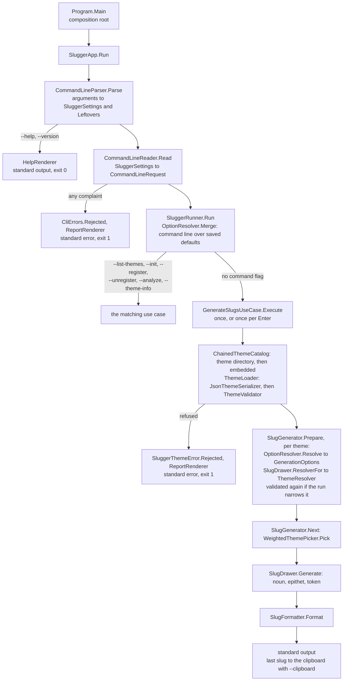

# Architecture

This page is a map of the code: what each assembly and namespace is for, how a command line becomes
a printed slug, where each concern lives and which decision records constrain which files. It
assumes you have read the [README](../README.md) and know what a slug and a theme are; the
vocabulary itself — slug, term, epithet, pool, segment — is defined in
[`ubiquitous-language.md`](ubiquitous-language.md). The newer types are named after it; the older
code still says "word" in places where the page would say "term".

For how to build, test and submit a change, see [`CONTRIBUTING.md`](../CONTRIBUTING.md); for the
files a common change touches, [`recipes.md`](recipes.md); for the public API as a library consumer
sees it, [`library.md`](library.md).

## Two assemblies, three layers

| Project | Ships as | Namespace | Visibility | Holds |
| --- | --- | --- | --- | --- |
| `src/Slugger` | the `Slugger.Core` package | `Slugger` | public | what a consumer uses: `SluggerTheme`, which loads and measures itself, `SlugGenerator`, `GenerationOptions` and the types around them |
| | | `Slugger.Errors` | public | the error model: `Outcome<T>`, `Error`, `ErrorCode`… |
| | | `Slugger.Domain` (and sub-namespaces) | internal | the theme model, resolution, drawing, rendering, validation, analysis |
| | | `Slugger.Application` | internal | the use cases, the precedence chain of options, the ports they need |
| | | `Slugger.Infrastructure` | internal | JSON reading, the embedded themes, the theme directory, the saved defaults |
| `src/Slugger.Cli` | the `Slugger` .NET tool, command `slugger` | `Slugger.Cli` | internal | the command line, the interactive loop, the composition root, rendering for the terminal, the clipboard adapter |

Three words from ports-and-adapters design recur on this page. A **port** is an interface the
application declares for something it needs from outside — reading themes, saving defaults, the
clipboard — and `src/Slugger/Application/Abstractions/` holds them. An **adapter** implements a
port with a real technology: the file system, System.Text.Json, TextCopy. The **composition root**
is the one place where the concrete classes are created and handed to each other, here
`Program.Main`; everything else receives what it needs through its constructor.

Dependencies point inwards only: `Domain` names nothing from `Application` or `Infrastructure`, and
`Application` names nothing from `Infrastructure`. The CLI and the three test projects reach the
internal layers through `InternalsVisibleTo`, declared in both `.csproj` files.

`Slugger` and `Slugger.Errors` are what a library consumer is promised, and nothing else: the
domain is internal too, so the namespaces a consumer imports say nothing of how the engine is built
([DEC0036](idr/DEC0036-api-publique-de-la-bibliotheque.md)). A public type wraps the domain - a
`SluggerTheme` holds a `ThemeDocument`, a `SlugGenerator` holds the resolvers it draws from - and
its signatures never name a use case or an infrastructure type. Publishing a type later breaks
nobody; unpublishing one breaks everyone who referenced it
([DEC0007](idr/DEC0007-surface-publique-reduite.md)).

### Why one assembly with three internal layers

The engine started as four assemblies, one per layer. Across assemblies, every layer has to be
public for the next one to use it, so four assemblies published the whole internal construction of
the engine. Merging them made `internal` possible, and the layers survive as namespaces: what
disappeared is a package graph a project this size has no use for, not the organisation of the code.

The cost is that the compiler no longer refuses a layering violation. Three test classes in
`tests/Slugger.ArchitectureTests/` replace it:

- `NamespaceDependencyTests` reads type signatures — base types, fields, properties, parameters,
  return types — and fails if a layer names a type from a layer further out. It also fails if
  `Application` or `Infrastructure` exposes a public type, if a type of the public `Slugger`
  namespace names a use case or an infrastructure type in its signatures, and if the engine
  references an assembly outside its whitelist (below).
- `LayeringTests` reads the compiled assembly with ArchUnitNET, so it also sees what a method body
  reaches for. The two are kept apart on purpose: one says what a layer publishes, the other what it
  touches.
- `ClipboardDependencyTests` fails if `TextCopy` ever reaches the engine, and checks that the CLI is
  where it is referenced.

The same project holds `ValueObjectRulesTests`, `EntityRulesTests` and `DehydrationTests`, which
measure the rules for value objects and entities summarised in
[`CONTRIBUTING.md`](../CONTRIBUTING.md#value-objects-and-errors).

### The packaging boundary decides where a dependency may sit

The one split that is kept, between `Slugger` and `Slugger.Cli`, is a real packaging boundary. A
dependency `Slugger` takes on reaches everyone who references the package, as a line in its nuspec;
one `Slugger.Cli` takes on stops at the executable, because a .NET tool bundles what it needs.

So the engine's dependency list is a whitelist kept deliberately short: `Value`, for the
`ValueType<T>` base of the value objects, and nothing else. The error model was `FirstClassErrors`
until it held the engine in preview; the engine now carries its own
([DEC0029](idr/DEC0029-modele-d-erreurs-propre-au-moteur.md)).
`NamespaceDependencyTests.The_engine_depends_on_nothing_but_what_was_deliberately_taken_on` lists
the whitelist, which makes adding to it a visible edit rather than an accident. `TextCopy` belongs to
the CLI alone: a clipboard has no meaning inside a slug engine. The CLI reads and draws its command
line itself, so that it compiles natively
([DEC0032](idr/DEC0032-ligne-de-commande-et-rendu-sans-spectre.md)).

The analyzers — `SonarAnalyzer.CSharp` and the `DiagnosticCatalog` packages — never reach a
consumer either, and two separate mechanisms make that true:

- A suppression written through `DiagnosticCatalog` uses compile-time constants, folded into the
  assembly before it is written, so nothing is left to reference at run time.
  `PackageWeightTests` measures that.
- `PrivateAssets="all"` keeps the analyzer packages out of the published dependency graph. No test
  reading the assembly can see that property: remove it and the nuspec grows a dependency while the
  compiled assembly does not change. The `AnalyzersStayPrivate` target in
  `Directory.Build.props` fails the build instead.

### Why the CLI assembly is not called `slugger`

A tool package ships the library beside the executable. An assembly called `slugger.dll` next to
`Slugger.dll` collides on a case-insensitive file system, so the CLI's assembly is `Slugger.Cli`,
and `ToolCommandName` in `Slugger.Cli.csproj` names the command `slugger`.

The package ids are a third thing again, chosen for whoever searches nuget.org: the tool is
`Slugger` and the library `Slugger.Core`
([DEC0033](idr/DEC0033-identifiants-de-paquet-inverses.md)). Neither the projects, nor the
assemblies, nor the namespaces follow them.

## From command line to printed slug



The same path in words, with the file each step lives in:

1. **`Program.Main`** (`src/Slugger.Cli/Program.cs`) is the composition root. It builds the ports by
   hand — `ThemeDirectory`, `XdgConfigStore`, `TextCopyClipboard`, and a `Terminal` on each standard
   stream, which draws colours only where a person reads it and never in a pipe or a file — and the
   use cases, and hands them all to a `SluggerRunner`. There is no dependency-injection container.
2. **`SluggerApp.Run`** (`CommandLine/SluggerApp.cs`) hands the line to
   **`CommandLineParser.Parse`** (`CommandLine/CommandLineParser.cs`), which binds it onto
   `SluggerSettings`, where every option is declared once — as text, or as a `FlagValue<string>` for
   a switch, which can be absent, on or explicitly off. The parser only places text: a word after an
   option is its value unless it is an option itself, so a lone `-` and a negative number are values,
   and `--word-sep=` is an empty one. What it cannot place — a word attached to no option, an option
   slugger does not have, an option missing its value — goes into `Leftovers` rather than stopping
   the read. `-h`, `--help`, `-v` and `--version` are answered wherever they are on the line, the help
   drawn by `HelpRenderer` from the same declarations
   ([DEC0019](idr/DEC0019-ligne-de-commande-declaree-et-rendue-par-spectre.md),
   [DEC0032](idr/DEC0032-ligne-de-commande-et-rendu-sans-spectre.md)).
3. **`CommandLineReader.Read`** (`CommandLine/CommandLineReader.cs`) converts every option and
   collects every complaint — the leftovers included — before refusing anything
   ([DEC0006](idr/DEC0006-rapport-groupe-des-refus.md)). It returns an
   `Outcome<CommandLineRequest>`: a `CliCommand`, the argument a command needs and a
   `SluggerOptions` in which null means "the command line said nothing about it". A refusal goes through
   `CliErrors.Rejected` and `ReportRenderer` to standard error, with exit code 1.
4. **`SluggerRunner.Run`** (`src/Slugger.Cli/SluggerRunner.cs`) reads the saved defaults through
   `IConfigStore.Read()` and prints its remarks — a file that is not JSON, an unknown key — as
   warnings. It merges the command line over the saved defaults with `OptionResolver.Merge`, warns
   about a theme directory that was named and does not exist and about any file in it whose name no
   `--theme` could select (`IThemeStore.Unselectable`), and switches on the `CliCommand`.
   Generating is the default. It loops — one round per Enter — unless `--oneshot` is set or
   standard input or standard output is not a terminal.
5. **`GenerateSlugsUseCase.Execute`** (`src/Slugger/Application/UseCases/`) asks the theme directory
   for a catalogue: a `ChainedThemeCatalog` over the `FileSystemThemeCatalog` and the
   `EmbeddedThemeCatalog`, so a file shadows a built-in theme of the same name. `--theme '*'` expands
   to every name the catalogue serves; no `--theme` means `slugger`.
6. **`ThemeLoader.Load`** (`src/Slugger/Infrastructure/Serialization/`) is the one path every theme
   takes, whichever catalogue it came from: `JsonThemeSerializer` reads the shape and normalises every
   word, then `ThemeValidator` runs the rules; their findings are reported together. The result is a
   `ThemeDocument`, or `SluggerThemeError.Rejected` carrying every reason. `SluggerTheme.Load*`, in the
   library, hands the accepted document out wrapped in a `SluggerTheme`, which never shows the words
   (DEC0034); the command stays on `ThemeDocument` and wraps it only to build a `SlugGenerator`.
7. **Per theme**, `OptionResolver.Resolve` collapses the precedence chain — command line, then the
   drawn theme's own `defaults` when a single theme is drawn or `--mimic-style` asks for them, then
   the saved defaults, then the program's — into `GenerationOptions`
   ([DEC0004](idr/DEC0004-chaine-de-priorite-unique.md)). `SlugDrawer.ResolverFor` builds the
   `ThemeResolver` for that run, narrowed by `--max-length` or `--max-segment-words` where they are
   set. A narrowed theme, or one drawn in a segment mode other than its own, is validated again,
   because it is not the theme that loaded
   ([DEC0018](idr/DEC0018-longueur-maximale-tenue-en-retirant-des-mots.md),
   [DEC0016](idr/DEC0016-planchers-alignes-sur-le-mode-de-segment.md)). All of this is
   `SlugGenerator.Prepare`, the internal side of the library's `SlugGenerator.For`, which the command
   calls with a refusal of its own and the options its precedence chain settled: it happens once per batch, never once per slug
   ([DEC0031](idr/DEC0031-source-de-slugs-preparee-une-fois.md)).
8. **For each slug**, `SlugGenerator.Next` has `WeightedThemePicker.Pick` choose a theme in proportion to its noun count,
   `SlugDrawer.Generate` draws a noun, the epithet the segment mode asks for and the token, and
   `SlugFormatter.Format` renders them into a string. One `DefaultRandomSource`, seeded from
   `--seed` when there is one, is created by the runner before the first round and handed to
   `GenerateSlugsUseCase.Execute` on every round, so a seeded session replays every slug, Enter
   after Enter.
9. The runner prints each slug on standard output. With `--clipboard`, the use case copies the last
   one through `IClipboard`. A copy that fails does not throw: its reason comes back in
   `GeneratedSlugs` beside the slugs, and the runner prints it as a warning on standard error,
   after them.

The other commands — `--list-themes`, `--init`, `--register`, `--unregister`, `--analyze` and
`--theme-info` — each have their own use case in `src/Slugger/Application/UseCases/` and their own
method in `SluggerRunner`.

## Where things live

| Concern | Files |
| --- | --- |
| Every option, its `--help` text | `src/Slugger.Cli/CommandLine/SluggerSettings.cs` |
| Converting and refusing the command line | `src/Slugger.Cli/CommandLine/CommandLineReader.cs`, `CliErrors.cs`, `CliErrorCodes.cs`, `CliCommand.cs` |
| Cutting the line into options and values | `src/Slugger.Cli/CommandLine/CommandLineParser.cs`, `DeclaredOption.cs`, `Leftovers.cs` |
| `--help`, its examples, `--version` | `src/Slugger.Cli/CommandLine/HelpRenderer.cs` |
| Colours, and where they are drawn | `src/Slugger.Cli/Rendering/Terminal.cs`, `Ink.cs` |
| Composition root | `src/Slugger.Cli/Program.cs` |
| Dispatch, interactive loop, what the terminal prints | `src/Slugger.Cli/SluggerRunner.cs`, `IConsole.cs`, `SystemConsole.cs` |
| Refusal reports, the `--analyze` report | `src/Slugger.Cli/Rendering/` |
| Clipboard | `src/Slugger/Application/Abstractions/IClipboard.cs` (port), `src/Slugger.Cli/Adapters/TextCopyClipboard.cs` (adapter) |
| Precedence chain of options | `src/Slugger/Application/Options/` |
| Use cases | `src/Slugger/Application/UseCases/` |
| Ports | `src/Slugger/Application/Abstractions/` |
| Reading a theme file | `src/Slugger/Infrastructure/Serialization/` |
| Finding a theme by name | `src/Slugger/Infrastructure/ThemeCatalogs/` |
| Built-in themes | `src/Slugger/Infrastructure/Resources/*.json`, minified and embedded by `src/Slugger/Slugger.csproj` |
| Saved defaults (`--init`) | `src/Slugger/Infrastructure/Configuration/XdgConfigStore.cs` |
| A theme as read from its file | `src/Slugger/Domain/ThemeDocument.cs`, `NounEntry.cs`; `src/Slugger/ThemeDefaults.cs`, `ThemeMetadata.cs`, `MaxLength.cs` |
| A theme as the library hands it out | `src/Slugger/SluggerTheme.cs` |
| Normalising a word at load | `src/Slugger/Domain/Normalization/WordNormalizer.cs` |
| Pools: categories, `common`, `except`, `incompatible`, the narrowing of a run | `src/Slugger/Domain/Resolution/ThemeResolver.cs` |
| Drawing from several themes | `src/Slugger/Domain/Resolution/WeightedThemePicker.cs` |
| Preparing and drawing, as a consumer does | `src/Slugger/SlugGenerator.cs` |
| Drawing a slug | `src/Slugger/Domain/Generation/SlugDrawer.cs`, `src/Slugger/SegmentMode.cs`, `src/Slugger/Domain/SegmentModes.cs` |
| Rendering a slug | `src/Slugger/Domain/Generation/SlugFormatter.cs` |
| Length budget | `src/Slugger/Domain/Generation/SlugBudget.cs` |
| Options handed to the engine | `src/Slugger/GenerationOptions.cs` |
| Randomness | `src/Slugger/IRandomSource.cs`, `DefaultRandomSource.cs` |
| Validation rules and floors | `src/Slugger/Domain/Validation/ThemeValidator.cs`, `ThemeCombinatorics.cs`; `src/Slugger/ThemeFloors.cs`, `src/Slugger/SluggerThemeError.cs` |
| Measuring a theme | `src/Slugger/Domain/Analysis/`; published as `src/Slugger/ThemeAnalysis.cs`, `ThemeMeasurements.cs`, `ThemeMargin.cs` (DEC0038) |
| Value objects of the new model | `src/Slugger/Domain/` — `Word`, `Term`, `Category`, `Chance`, `Token`…, with an `Error` and an `Exception` beside each one that can refuse a value |
| Loading a theme, as a consumer does | `src/Slugger/SluggerTheme.cs` |
| Analyzer suppression reasons | `src/Slugger/SuppressionJustifications.cs` |
| Themes shipped as files | `themes/` |
| Pinned output of every theme | `tests/Slugger.Cli.UnitTests/GoldenMaster/` |
| Rules about the shape of the code | `tests/Slugger.ArchitectureTests/` |

## Two theme models, side by side

A refactoring is in progress, and it leaves two models of a theme in the code. Read
[`refactoring-in-progress.md`](refactoring-in-progress.md) before you change either.

| | Used by the engine today | Built, not yet wired in |
| --- | --- | --- |
| The theme | `ThemeDocument` (internal) — the shape of the file, words as strings — handed out wrapped in `SluggerTheme` (public, opaque) | `Theme` (internal, `[Entity]`) — nothing builds one yet |
| Where themes come from | `IThemeCatalog` (internal), implemented by the embedded, file-system and chained catalogues | `ICatalog` (internal, `[Repository]`) — no implementation yet |
| The words | `string`, everywhere: `ThemeResolver`, `SlugDrawer`, `ThemeValidator` | `Word`, `Term`, `Noun`, `Adjective`, `Participle`, `Epithet`, `Slug`… pinned by their own tests |

Every catalogue hands back a `ThemeDocument`, and every `SluggerTheme` that `SluggerTheme.Load*`
returns and `SlugGenerator.For` takes wraps one. **A fix to how slugs are drawn, validated or rendered belongs in the
`ThemeDocument` path**: a change made only to `Theme` or `ICatalog` changes nothing a user can see.
The only bridge built so far is `SlugFormatter.Format(Slug, GenerationOptions)`, which renders a
`Slug` of the new model; its tests call it, and the engine does not yet.

**Every type of the new model is internal**, the bridge included, until the engine uses it: a
consumer can only build on what loading and generation actually run on. `PublicSurfaceTests` lists
every public type of the engine, so publishing one of them is an edit to that list, made in the
pull request that wires it in.

## How a refusal travels

Loading a theme and reading a command line never throw to refuse. Each reason for a refusal is an
`Error` - a `SluggerThemeError` for a theme, a `DomainError` from `CliErrors` for the command line -
and the refusal travels in an `Outcome<T>`. The model is the engine's own, in
`src/Slugger/Errors/` ([DEC0029](idr/DEC0029-modele-d-erreurs-propre-au-moteur.md)), and only
the engine builds an error: its primitives and every catalogue's factories are internal
([DEC0035](idr/DEC0035-erreur-de-theme-du-theme-public.md)).

- Each situation has a factory — `SluggerThemeError.PoolTooSmall(...)`, `CliErrors.NotAWholeNumber(...)` —
  which writes the message once.
- `SluggerThemeError.Rejected` and `CliErrors.Rejected` wrap every reason as inner errors, so one run
  reports all of them ([DEC0006](idr/DEC0006-rapport-groupe-des-refus.md)).
- `ReportRenderer` in the CLI prints each reason's diagnostic message, grouped by error code: it
  names three of each kind and counts the rest. `--register` and a load at run time call the same
  factories, so they print the same words.
- The throwing shapes — `SluggerTheme.LoadEmbeddedOrThrow`, `SlugGenerator.ForOrThrow` and the like — raise a `SluggerThemeException`, whose
  `Error` holds the same report.

Two styles of error type coexist in the code; [`CONTRIBUTING.md`](../CONTRIBUTING.md#value-objects-and-errors)
says which one new code uses.

## Decisions by code area

The decision records in [`idr/`](idr/README.md) say why the code is the way it is, and what each
decision rules out. They are in French. The table that maps each area of the code to the decisions
that constrain it is in the [decision index](idr/README.md#decisions-by-code-area). To find the
decisions a file names, run:

```bash
grep -rn DEC00 src/Slugger/Domain/Resolution/ThemeResolver.cs
```
